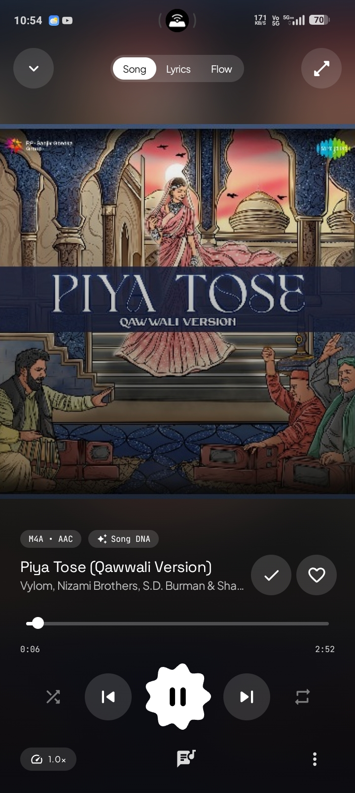
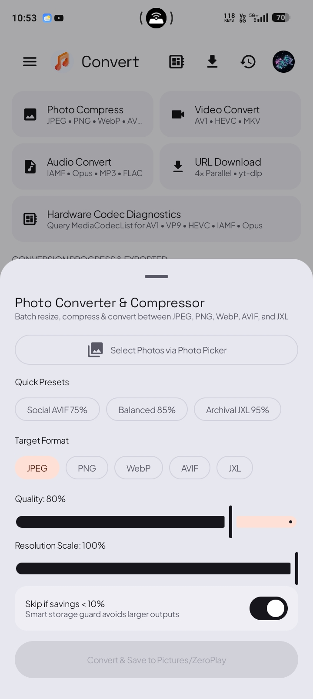
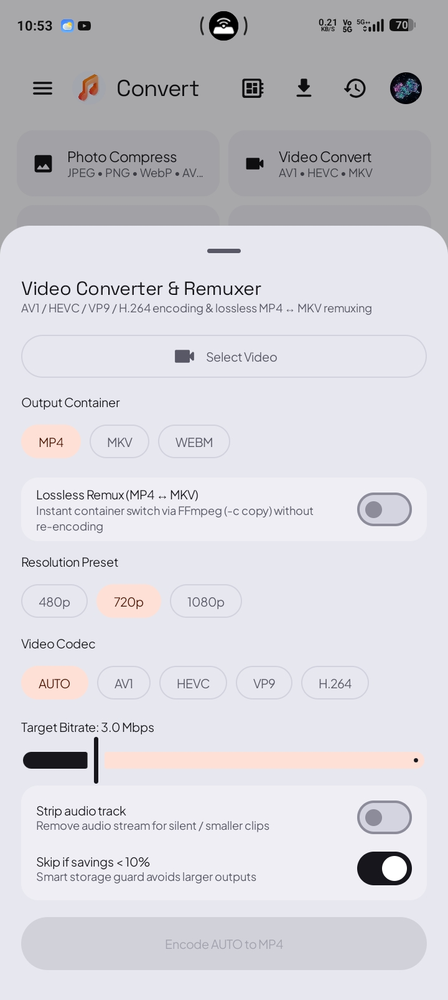
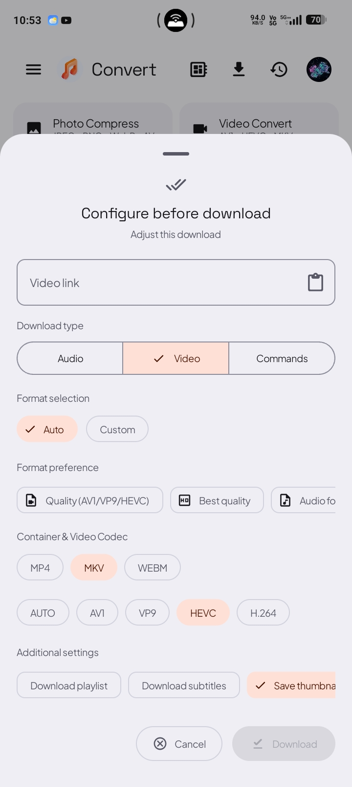

<div align="center">
  
  <h1>Zero Play</h1>
  <p><strong>Unified</strong> — An all-in-one Android Audio Player, Video Player, Media Downloader, and Photo/Video/Audio Converter built with Kotlin &amp; Jetpack Compose.</p>

  <p>
    <a href="https://github.com/tanmaydatta-15/Zero-play-/releases">
      
    </a>
    
    
    
    <a href="LICENSE">
      
    </a>
  </p>
</div>

---

## Overview

**Zero Play** delivers a clean, ad-free mobile media suite powered by Jetpack Compose and AndroidX Media3. Designed with Material 3 Expressive surfaces, it unifies offline & stream audio/video playback, real-time synchronized lyrics, Picture-in-Picture video, direct media stream downloading, hardware-accelerated media conversion, and built-in GitHub self-updates in a single native Android APK.

> [!NOTE]
> **Built-In GitHub Self-Update:** Zero Play checks [`tanmaydatta-15/Zero-play-`](https://github.com/tanmaydatta-15/Zero-play-/releases) directly inside **Settings → Auto update** (supporting both **Stable** and **Preview** channels) and supports Play Store-style binary delta patching.

## 📸 Screenshots

| Now Playing | Media Converter | Video Remuxer | Download Manager |
| :---: | :---: | :---: | :---: |
|  |  |  |  |


## Table of Contents

- [Overview](#overview)
- [Features](#features)
- [Installation & Setup](#installation--setup)
- [Developed & Designed By](#developed--designed-by)
- [Core Stack & Acknowledgements](#core-stack--acknowledgements)
- [Legal Disclaimer & Terms of Use](#legal-disclaimer--terms-of-use)

---

## Features

<details>
<summary><strong>Audio & Video Playback</strong></summary>

- **Media3 ExoPlayer & MediaSessionService:** Background playback with rich system notification artwork (album covers & video frame thumbnails), Audio Focus handling, and headset disconnect auto-pause.
- **Full-Featured Video Player:** Smooth status bar contrast, slim interactive scrubber, `-10s` / `+10s` quick seek controls, **Fit / Zoom** aspect ratio toggle, and **Picture-in-Picture (PiP)** support.
- **Audio Engine Controls:** Skip Silence toggle, volume normalization, adjustable playback speed (`0.75x` – `2.0x`), gapless queue flow, and crossfade options.

</details>

<details>
<summary><strong>Discovery, Lyrics & Library</strong></summary>

- **Mood & Station Curations:** Pill-shaped mood filters (`Feel good`, `Romance`, `Relax`, `Party`, `Energy`), carousel highlights, Forgotten Favorites, and Station / Listen Together queues.
- **Synchronized Lyrics & Audio Telemetry:** Word-by-word animated synced lyrics alongside song format quality badges (`FLAC`, `WAV`, `M4A`, `MP4`) and Song DNA info sheets.
- **Organized Library:** Custom playlists, quick category tiles (`Liked`, `Downloaded`, `Exported`, `Cached`, `Top 50`, `Local`), sorting controls, and a toggleable **2-Column Circular Artist Portrait Grid**.

</details>

<details>
<summary><strong>Configure Before Download</strong></summary>

- **Flexible Download Modes:** Switch cleanly between **Audio**, **Video**, and **Commands** segments with `Auto` or `Custom` format selection.
- **Granular Quality Controls:**
  - **Preferred video format:** Choose **Legacy** (MP4 / H.264 compatibility) or **Quality** (AV1 / VP9 / H.265).
  - **Video quality limit:** Select `Best quality`, `2160p`, `1440p`, `1080p`, `720p`, `480p`, `360p`, or `Lowest quality`.
  - **Audio format & quality:** Choose `Not specified (default)`, `M4A / AAC`, `MP3`, `Opus`, or `FLAC` with quality caps and conversion toggle.
- **Batch & Extras:** Support for playlist/multi-line links, subtitle embedding, thumbnail saving, and direct stream validation that prevents saving HTML webpages as broken media files.

</details>

<details>
<summary><strong>Photo, Video & Audio Converter / Compressor</strong></summary>

- **Video Compressor:** Hardware-accelerated H.264 / HEVC compression via Media3 `Transformer` with live estimated file size & savings readout, custom bitrate slider, optional audio stripping, and `Movies/ZeroPlay` export.
- **Photo Batch Converter:** Batch compress, scale (`25%` – `100%`), strip EXIF metadata, and convert photos between **WebP**, **JPEG**, and **PNG** using the zero-permission Android Photo Picker.
- **Audio Extractor:** Extract clean `.m4a` audio tracks directly from any video using `MediaExtractor` + `MediaMuxer`.
- **Smart Storage Guard:** Automatically skips saving compressed files if space savings fall below `10%`.

</details>

<details>
<summary><strong>Customization & Self-Update Engine</strong></summary>

- **Themes:** Material 3 Expressive with **System**, **Light**, **Dark**, **Pure Black AMOLED**, and **Material You Dynamic Color**.
- **In-App Auto Update:** Pre-configured for [`tanmaydatta-15/Zero-play-`](https://github.com/tanmaydatta-15/Zero-play-) with **Stable** and **Preview** channels, background update checks, per-ABI delta patch downloads, SHA-256 verification, and native Android `PackageInstaller` installation.

</details>

---

## Installation & Setup

### Android Installation

1. Download the latest pre-compiled APK from the [**Releases Page**](https://github.com/tanmaydatta-15/Zero-play-/releases).
2. Install the APK on your Android device (`Android 7.0+` / API 24+).
3. Once installed, open **Settings → Auto update** to receive future releases directly inside the app.

<details>
<summary><strong>Building from Source</strong></summary>

```bash
git clone https://github.com/tanmaydatta-15/Zero-play-.git
cd Zero-play-
base64 -d debug.keystore.base64 > debug.keystore
gradle assembleDebug
```

The compiled APK will be generated at `app/build/outputs/apk/debug/app-debug.apk` (and copied to `./app-debug.apk`).

Automated builds are also configured in [`.github/workflows/release-apk.yml`](.github/workflows/release-apk.yml): pushing version updates (`versionCode` / `versionName` in `app/build.gradle.kts`) automatically builds and publishes an APK release on GitHub.

</details>

---

## Developed & Designed By

**Tanmay Datta** — *Unified*

- Instagram: [@tanmay.sudo](https://www.instagram.com/tanmay.sudo?dmpr=MXdncXZob2xja2k2dA==)
- Repository: [tanmaydatta-15/Zero-play-](https://github.com/tanmaydatta-15/Zero-play-)

---

## Core Stack & Acknowledgements

Zero Play is built with modern open-source Android libraries:

| Technology | Role |
| :--- | :--- |
| **Jetpack Compose & Material 3** | Declarative UI, adaptive layouts, and Material 3 Expressive styling |
| **AndroidX Media3** | `ExoPlayer`, `MediaSessionService`, and `Transformer` video compression |
| **Room & Jetpack DataStore** | Local library persistence, playlists, conversion logs, and preferences |
| **Coil Compose** | Fast asynchronous artwork and thumbnail loading |
| **Kotlin Coroutines & Flow** | Reactive state management and background media processing |

---

## Legal Disclaimer & Terms of Use

### 1. Free, Open-Source & Non-Commercial
Zero Play is a free, open-source Android project created for personal and educational use. There are no ads, paywalls, subscriptions, or hidden fees inside the application.

### 2. Local Playback & User-Provided Streams
All offline playback, photo/video compression, and audio extraction run locally on the user's device. When using the media downloader, Zero Play only fetches direct media URLs explicitly provided by the user.

### 3. No Hosting of Copyrighted Material
This repository does not host, distribute, or store any third-party audio, video, or copyrighted media files.

### 4. User Responsibility
The software is provided **"AS IS"**, without warranty of any kind. Users are solely responsible for ensuring that their use of any third-party stream URLs complies with applicable local copyright laws and platform terms of service.

---

<p align="center">
  Licensed under <a href="LICENSE">GPL-3.0</a> • Unified
</p>
